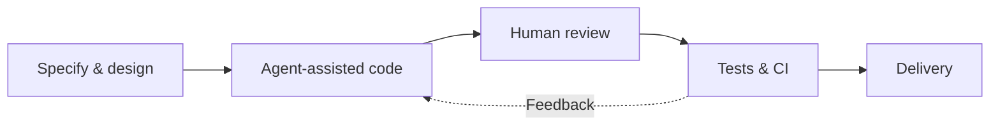

<!-- Aleksandr Shereshkov | Engineering portfolio -->

  
  <h3>Backend Architecture · Application Security · AI-Assisted Engineering</h3>
  
Building secure web applications, reliable APIs, and developer tools. Ukraine 🇺🇦 · Remote collaboration

  
  
  
  
<a href="#selected-projects">Projects</a> · <a href="#ai-assisted-engineering">AI workflow</a> · <a href="#technology-stack">Tech stack</a> · <a href="#github-activity">GitHub activity</a>

## About

I'm a **Full-Stack Software Engineer** with a strong backend and system-design focus. I work across the development lifecycle, from requirements and architecture to implementation, testing, deployment, and maintenance.

<table>
  <tr>
    <td width="50%" valign="top">
      <h3>01 / Full-Stack Engineering</h3>
      Type-safe web applications, reusable interfaces, API integration, and predictable state management.
        <code>React</code> <code>Next.js</code> <code>TypeScript</code>
    </td>
    <td width="50%" valign="top">
      <h3>02 / Backend &amp; Architecture</h3>
      Modular services, REST APIs, relational data modeling, transactions, and system design.
        <code>NestJS</code> <code>Node.js</code> <code>PostgreSQL</code>
    </td>
  </tr>
  <tr>
    <td width="50%" valign="top">
      <h3>03 / Application Security</h3>
      Authentication, authorization, server-side session lifecycle, and defense-in-depth controls.
        <code>JWT</code> <code>RBAC</code> <code>OWASP</code>
    </td>
    <td width="50%" valign="top">
      <h3>04 / AI-Assisted Engineering</h3>
      Agent-assisted development, specification-driven changes, automated verification, and LLM evaluation.
        <code>Codex</code> <code>Claude</code> <code>Local LLMs</code>
    </td>
  </tr>
</table>

> I use AI to accelerate engineering, not to outsource engineering judgment. Correctness, security, and maintainability remain the priorities.

## Selected projects

### 01 · Authentication & session management

A modular backend exploring reusable, security-focused authentication and stateful session management on top of JWT.

- Server-side session validation and revocation; atomic refresh-token rotation and reuse detection.
- Role-based access control, CSRF defenses, account lockout, and request throttling.
- PostgreSQL constraints and indexes enforce session invariants beyond application-level checks.
- Threat-model documentation, structured security logging, and Redis-backed replay protection for M2M requests.

`NestJS` · `TypeScript` · `Prisma` · `PostgreSQL` · `Redis` · `JWT`

[Explore the architecture and security design →](https://github.com/AleksandrSherehkov/mud-state-backend#readme)

### 02 · AI-assisted localization & developer tooling

A domain-specific localization pipeline focused on consistent terminology, structured resource integrity, and reproducible processing.

- Terminology discovery, glossary management, and human-in-the-loop review.
- Checkpoint/resume, preflight validation, and controlled application of changes.
- Cross-platform test automation and comparative evaluation of local language models.

`TypeScript` · `CLI` · `LLMs` · `GitHub Actions` · `Automated Testing`

### 03 · Document generation & processing

Backend services that transform structured business data into HTML and PDF documents, with a focus on input validation, reliable processing, and maintainable integrations.

`Node.js` · `TypeScript` · `JSON` · `HTML` · `PDF`

[Browse public repositories →](https://github.com/AleksandrSherehkov?tab=repositories)

## AI-assisted engineering

  
  
  
  

My workflow combines AI coding agents with explicit technical specifications, scoped changes, human review, and automated verification.

**Beyond coding assistance:** I evaluate Qwen, Gemma, and TranslateGemma on domain-specific translation tasks, checking output quality, terminology consistency, and resource-format preservation.

**Quality gates:** review diffs · verify behavior · test regressions · check security boundaries · protect sensitive data.

## Technology stack

<table>
  <tr>
    <td width="50%" valign="top">
      <h3>Frontend &amp; UI</h3>
      
      
React · Next.js · Tailwind CSS · Styled Components · Radix UI

      
<strong>State &amp; data:</strong> Redux Toolkit · RTK Query · TanStack Query · Zustand

    </td>
    <td width="50%" valign="top">
      <h3>Backend &amp; APIs</h3>
      
      
Node.js · NestJS · Express.js · REST APIs · TypeScript

      
<strong>Data access:</strong> Prisma · TypeORM · Mongoose

    </td>
  </tr>
  <tr>
    <td width="50%" valign="top">
      <h3>Databases &amp; Storage</h3>
      
      
PostgreSQL · MySQL · MariaDB · MongoDB · Redis

      
<strong>Core:</strong> SQL · relational modeling · constraints · transactions

    </td>
    <td width="50%" valign="top">
      <h3>Infrastructure &amp; Delivery</h3>
      
      
Docker · Docker Compose · Nginx · Linux

      
<strong>Delivery:</strong> Git · GitHub Actions · CI/CD · Bash

    </td>
  </tr>
  <tr>
    <td width="50%" valign="top">
      <h3>Testing &amp; Quality</h3>
      
      
Jest · Supertest · ESLint · Prettier

      
<strong>Practices:</strong> integration testing · regression checks · code review

    </td>
    <td width="50%" valign="top">
      <h3>Security &amp; Reliability</h3>
      
      
      
      
Token rotation · session management · CSRF protection

      
<strong>Practices:</strong> rate limiting · replay protection · threat modeling

    </td>
  </tr>
</table>

  
<b>Additional technologies &amp; tools</b>

   
  
  
Vue.js · React Native · HTML5 · CSS3 · Sass · Framer Motion · GSAP · Vercel · VS Code

## GitHub activity

  <picture>
    <source media="(prefers-color-scheme: dark)" srcset="https://streak-stats.demolab.com?user=AleksandrSherehkov&amp;theme=github-dark-blue&amp;hide_border=true&amp;ring=58A6FF&amp;fire=2DD4BF&amp;currStreakLabel=58A6FF" />
    
  </picture>
   
  <picture>
    <source media="(prefers-color-scheme: dark)" srcset="https://github-readme-activity-graph.vercel.app/graph?username=AleksandrSherehkov&amp;hide_border=true&amp;area=true&amp;bg_color=0D1117&amp;color=C9D1D9&amp;line=58A6FF&amp;point=2DD4BF" />
    
  </picture>

  
<b>Beyond engineering</b>

   
  
  
Outside software engineering, I enjoy feeder angling and carp fishing — patience, precision, and continuous learning apply there too.

---

  <strong>Good software is built with intention, verified with evidence, and improved continuously.</strong>
  
<a href="https://www.linkedin.com/in/aleksandr-shereshkov/">LinkedIn</a> · <a href="mailto:aleksandr.shereshkov@gmail.com">Email</a> · <a href="https://t.me/Alexander_Shereshkov">Telegram</a>

